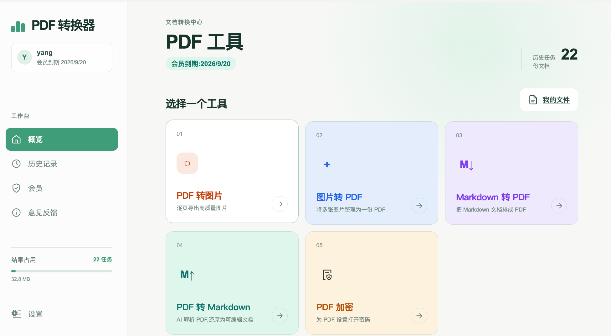
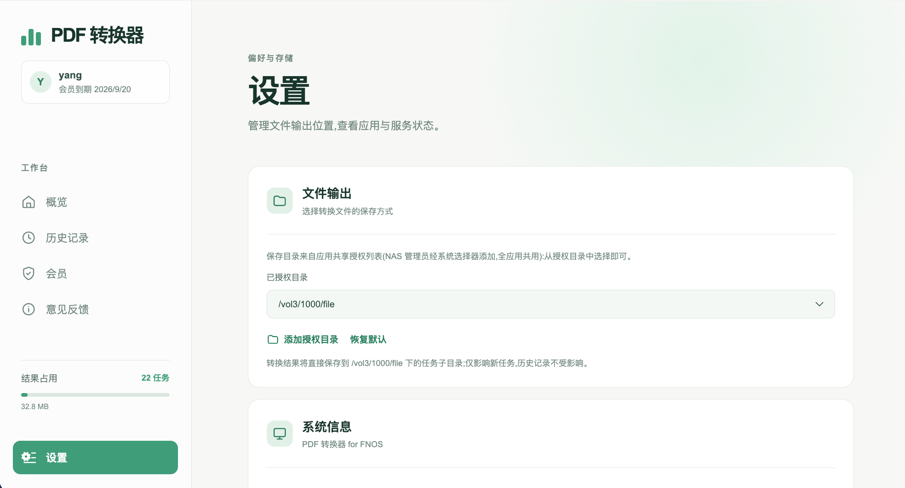
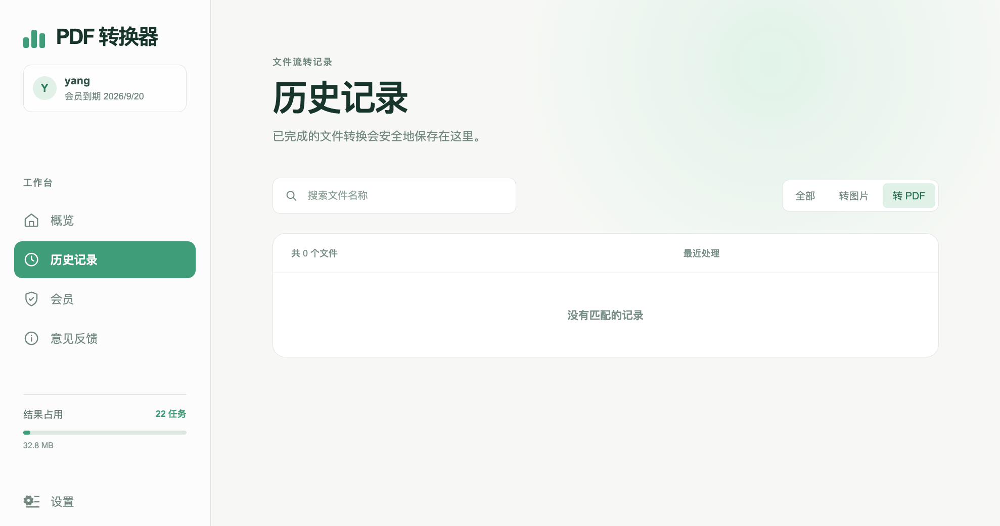
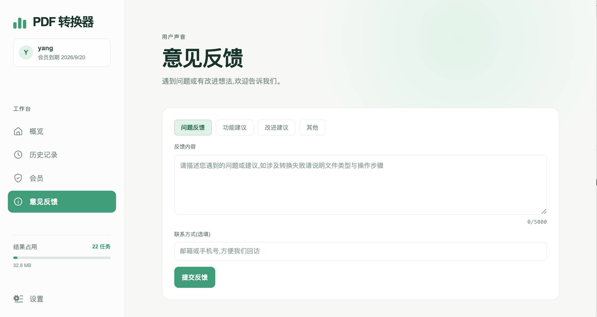

# PDF 转换器 for fnOS

## 一、介绍

PDF 转换器是一款运行在 [fnOS(飞牛OS)](https://www.fnnas.com/) 上的文档转换工具,支持 PDF、图片、Markdown 多格式互转。从飞牛OS 桌面打开即自动以当前 fnOS 账户身份使用,**免注册、免登录**,转换结果直接保存在你自己的 NAS 里。

当前版本 v1.0.0,已在 fnOS 应用商店上架(x86 架构)。

**注意事项:**

- 仅支持 **x86 架构**的 fnOS
- 使用时需 NAS 能够访问外网
- 首次使用前,需由 NAS **管理员**在设置页为应用授权共享目录(见下方「开始使用」)
- PDF → Markdown 为深度解析,大文件耗时几分钟属正常现象,期间可离开页面

### 六大优势

- **免登录**:绑定 fnOS 账户,从桌面打开即用,无需注册
- **NAS 文件直接转换**:文件选择器直接勾选 NAS 里的文件,不用先下载到电脑再上传
- **格式全面**:PDF → 图片、图片 → PDF、Markdown → PDF、PDF → Markdown/Word、PDF 加密,覆盖日常文档场景
- **结果只存本机**:转换结果保存在你自己选择的授权目录,按账户隔离,他人不可见
- **按月订阅**:非会员按可用次数使用,微信扫码订阅会员(按月),有效期内不限次数,支付后实时到账
- **隐私安全**:不收集个人信息,读取范围仅限你明确授权的文件

## 二、如何使用

### 安装

支持平台:fnOS(x86)。

1. 打开 fnOS **应用中心**,找到「PDF 转换器」安装;或下载 `.fpk` 安装包后选择手动安装
2. 安装完成后桌面出现「PDF 转换器」图标,点击即可使用

### 开始使用

**第 1 步:管理员授权目录(仅首次)**

由 NAS **管理员**打开应用,进入「设置 → 文件保存目录」,点击添加,在系统弹窗中勾选 NAS 上的共享文件夹完成授权。只有管理员能添加授权目录。

**第 2 步:选择保存目录**

每位用户首次使用时,应用会引导从**已授权目录**中选一个作为自己的保存位置(下拉框直选)。之后所有转换结果都保存到这里,同一台 NAS 上不同账户互不可见。

**第 3 步:开始转换**

进入任意工具页,把文件拖进虚线框,或点「从 NAS 选择」直接勾选 NAS 里的文件,选好参数点开始转换即可。完成后页面直接给出下载入口,历史记录里也随时可以找回。

### 功能说明

| 工具 | 说明 |
| --- | --- |
| PDF → 图片 | 按页码范围转换,可选格式(png/jpg)、色彩、DPI;默认合并为一张长图,也可逐页拆分 |
| 图片 → PDF | 多张图片合并为一个 PDF,或逐张分别转换 |
| Markdown → PDF | 把 Markdown 文档渲染排版为 PDF |
| PDF → Markdown / Word | 基于 MinerU 精准解析,支持 OCR、公式与表格识别,输出 Markdown(图片内联)或 Word 文档 |
| PDF 加密 | 为 PDF 设置打开密码,保护文件内容 |

**历史记录**:每次转换自动留档,可搜索、按类型筛选、重新下载;多张图片结果点击可放大逐张预览;删除仅移除本机记录,不动已保存的结果文件。

**会员**:非会员按可用次数使用;微信扫码**按月订阅**会员,有效期内不限次数、剩余次数完整保留,到期后可继续使用,续费时长自动叠加。支付完成后侧边栏的用户信息会自动刷新。

**意见反馈**:遇到问题或有改进想法,在「意见反馈」页提交,可选类型(问题反馈 / 功能建议 / 改进建议 / 其他),可留联系方式方便回访。

## 三、常见问题

**为什么提示「请先选择文件保存目录」?**
你还没有选择保存目录,按提示到设置页从授权目录中选一个即可。

**下拉框里没有可选的目录?**
说明管理员还没有为应用授权任何目录,请联系 NAS 管理员先在设置页添加。

**我不是管理员,可以添加授权目录吗?**
不可以。为避免越权访问,授权目录只能由 NAS 管理员添加,普通用户从已授权列表中选择。

**提示「文件保存目录未授权」?**
该目录的授权已被管理员移除或变更,回设置页重新选一个已授权的目录即可。

**支持多大的文件?**
PDF → 图片、图片 → PDF 单文件最大 100MB;Markdown → PDF 与 PDF 加密最大 50MB;PDF → Markdown / Word 最大 200MB。

**PDF → Markdown / Word 为什么比较慢?**
该功能在远程服务端做深度解析(含 OCR、表格识别),大文件可能需要几分钟,期间可以离开页面,回来在历史记录里查看结果。

**转换的文件保存在哪里?其他人能看到吗?**
保存在你自己选择的授权目录里,按 fnOS 账户区分,同一台 NAS 上其他用户看不到你的记录;删除记录也不影响已保存的结果文件。

**支付成功后权益没变化?**
支付到账后应用会自动刷新,个别情况可关闭弹窗或重新打开应用查看;仍不到账请通过「意见反馈」附上订单号联系我们。

**会员到期后历史记录还在吗?**
在。历史记录保存在本机,随时可以查看和重新下载结果文件。

**转换是在哪里完成的?我的文件安全吗?**
文件发送到远程转换服务处理,结果只落盘到本 NAS 的授权目录;应用不收集任何个人信息,读取范围仅限你通过系统选择器明确授权的文件。

**应用打不开或显示异常?**
先在应用中心将应用停止再启用;仍异常请通过「意见反馈」描述现象与操作步骤。

## 四、联系我们

使用问题或建议请优先使用应用内「意见反馈」,我们会尽快处理。
